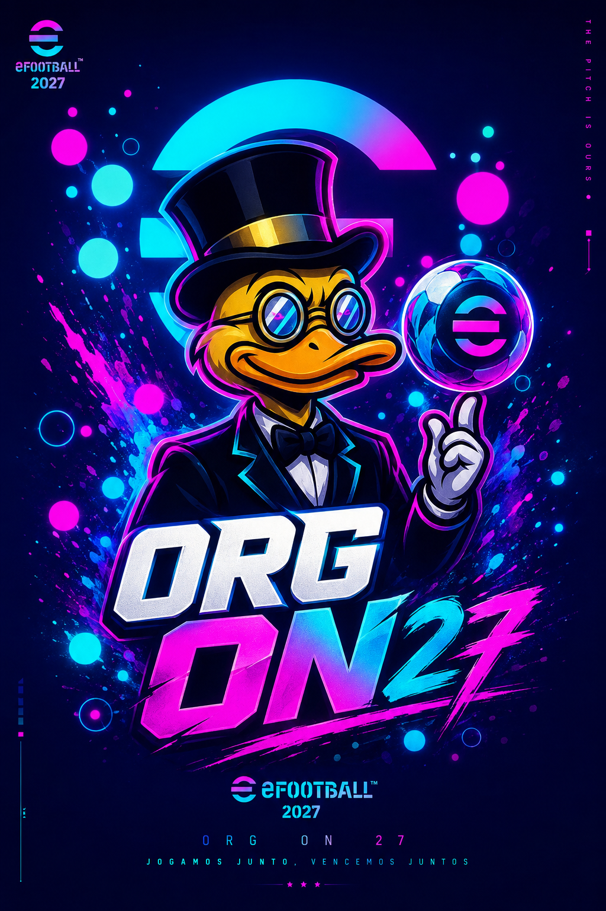
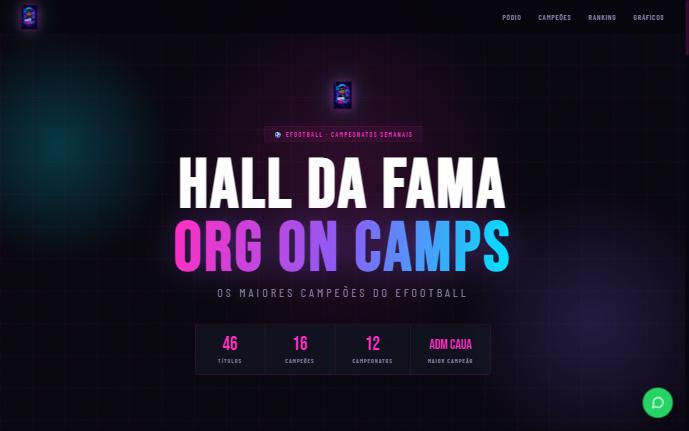
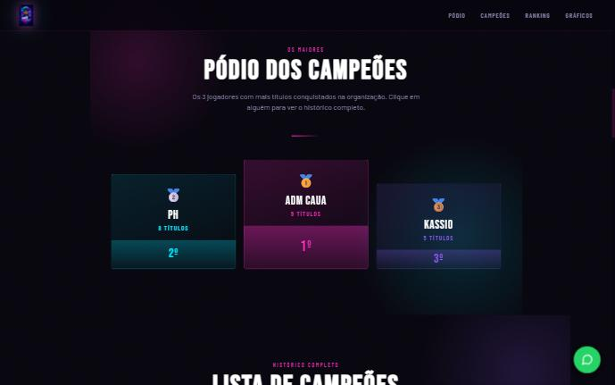
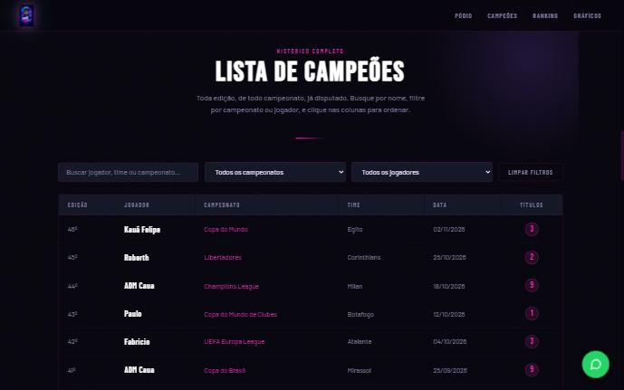
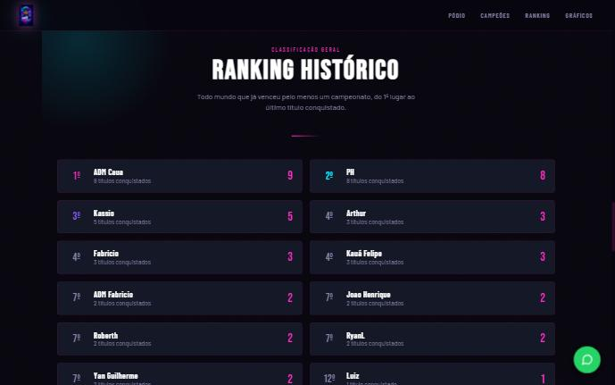
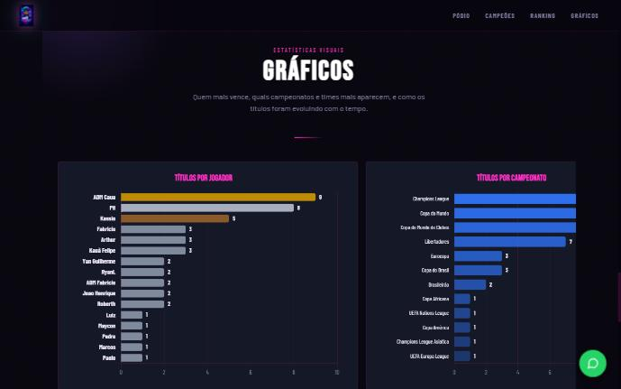
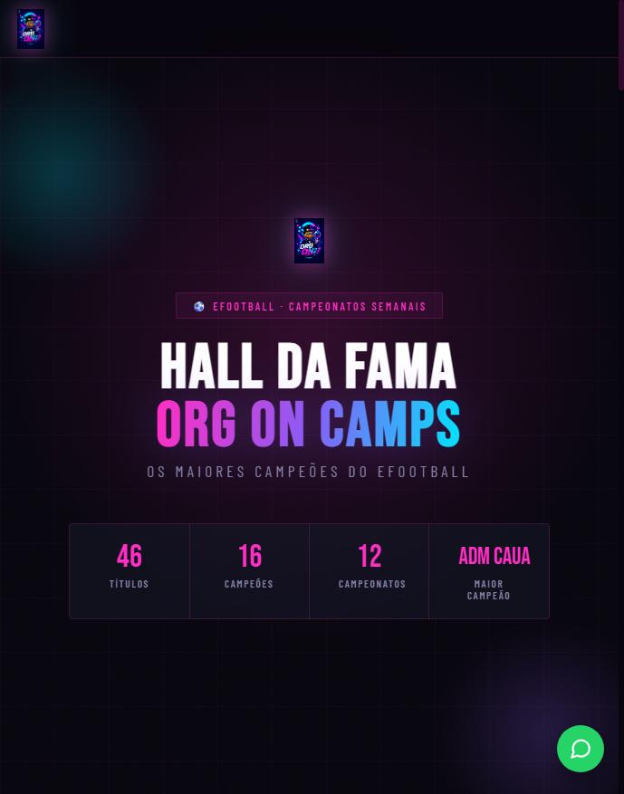
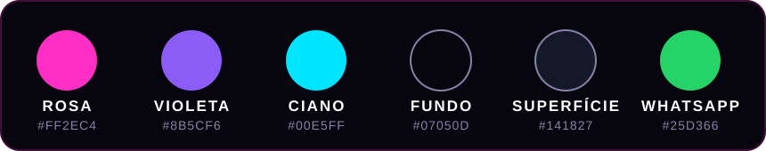

<div align="center">



# 🏆 HALL DA FAMA · ORG ON CAMPS

### ⚽ Os maiores campeões do eFootball

Um site que reúne **todos os campeões dos campeonatos semanais de eFootball** da ORG ON CAMPS: pódio, ranking histórico, lista completa de edições e estatísticas visuais.

<br />

<a href="https://hall-da-fama-theta.vercel.app/"></a>
&nbsp;
<a href="https://chat.whatsapp.com/IbF3DjtJJ00LP0znsKEipL?mode=gi_t"></a>

<br />
<br />

<a href="https://hall-da-fama-theta.vercel.app/"></a>

<br />


[🎯 Sobre](#-sobre-o-projeto) · [📸 Galeria](#-galeria) · [✨ Funcionalidades](#-funcionalidades) · [🛠️ Tecnologias](#️-tecnologias-utilizadas) · [🎨 Identidade visual](#-identidade-visual) · [📁 Estrutura](#-estrutura-do-projeto) · [🚀 Como rodar](#-como-rodar-localmente)

</div>


## 🎯 Sobre o projeto

A **ORG ON CAMPS** organiza campeonatos semanais de **eFootball**. Com o passar das edições, o histórico de campeões ficou espalhado e difícil de consultar.

O **Hall da Fama** nasceu para resolver isso: um lugar único, rápido e bonito para **celebrar quem venceu**, registrar a história da organização e mostrar, com dados, quem são os maiores campeões.

**Para quem é:**

- 🎮 **Jogadores**: conferir o próprio histórico de títulos e a posição no ranking.
- 👀 **Visitantes**: conhecer a comunidade e ver o nível dos campeonatos.
- 🛡️ **Administração**: ter um registro oficial e organizado de todas as edições.

> 💬 Quer jogar com a gente? Use o botão **ENTRAR NA ORG** lá em cima ou o botão flutuante do WhatsApp no próprio site.


## 📸 Galeria

<div align="center">

### 🥇 Pódio dos Campeões


<br />

### 📋 Lista de Campeões


<br />

### 📈 Ranking Histórico


<br />

### 📊 Gráficos


<br />

### 📱 Versão mobile


</div>


## ✨ Funcionalidades

| | Recurso | Descrição |
|---|---------|-----------|
| 🥇 | **Pódio dos Campeões** | Os 3 jogadores com mais títulos. Ao clicar em um deles, abre o histórico completo. |
| 📋 | **Lista de Campeões** | Todas as edições de todos os campeonatos, com edição, jogador, campeonato, time, data e títulos. |
| 🔎 | **Busca e filtros** | Pesquise por jogador, time ou campeonato e filtre por campeonato ou jogador, com botão para limpar os filtros. |
| ↕️ | **Ordenação** | Clique nas colunas da tabela para ordenar. |
| 📈 | **Ranking Histórico** | Todos que já venceram pelo menos um campeonato, do 1º ao último colocado em títulos. |
| 📊 | **Gráficos** | Títulos por jogador, por campeonato, times mais frequentes e a evolução dos títulos ao longo do tempo. |
| 💬 | **Botão flutuante do WhatsApp** | Atalho fixo na tela para entrar no grupo da org. |
| 📱 | **Responsivo** | Layout pensado para celular e computador. |
| 🔗 | **Compartilhamento** | Metadados Open Graph e Twitter Card para um preview bonito ao compartilhar o link. |

<details>
<summary><b>🔍 Ver mais detalhes de cada seção</b></summary>

<br />

**Pódio**
Destaca os três maiores campeões da organização. Cada card é clicável e mostra o histórico completo do jogador.

**Campeões**
Tabela completa e interativa com todas as edições já disputadas. Combina busca por texto, filtros por campeonato e por jogador, e ordenação por qualquer coluna.

**Ranking**
Classificação geral baseada na quantidade de títulos, listando todos os jogadores que já conquistaram ao menos uma taça.

**Gráficos**
Visualização dos dados para entender a evolução da organização: líderes de títulos, distribuição por campeonato e por time, e linha do tempo das conquistas.

</details>


## 🛠️ Tecnologias utilizadas

<div align="center">

| Camada | Tecnologia | Uso no projeto |
|:------:|:----------:|:---------------|
| 🧱 **Estrutura** |  | Marcação semântica, seções e metadados de SEO/redes sociais |
| 🎨 **Estilo** |  | Layout responsivo, variáveis CSS e visual neon da org |
| ⚙️ **Lógica** |  | Tabela, busca, filtros, ordenação, pódio e ranking (JS puro, sem framework) |
| 📊 **Gráficos** |  | Gráficos de barras e evolução dos títulos, com o plugin `chartjs-plugin-datalabels` para exibir os valores |
| 🔤 **Fontes** |  | Bebas Neue (títulos), Barlow Condensed e Barlow (textos) |
| 🗂️ **Dados** |  | Registro de todos os campeões em um único arquivo, fácil de atualizar |
| ☁️ **Hospedagem** |  | Deploy contínuo e publicação do site |

</div>

> 💡 O projeto é **100% front-end e sem build**: basta abrir o `index.html`. Mantê-lo simples facilita a manutenção por qualquer pessoa da org.


## 🎨 Identidade visual

O site usa um tema **neon escuro**, com rosa, violeta e ciano sobre fundo quase preto, e o verde do WhatsApp só nos botões da comunidade.

<div align="center">

</div>


## 📁 Estrutura do projeto

```text
hall-da-fama/
├── index.html          # Página principal
├── css/
│   └── style.css       # Estilos do site
├── data/
│   └── data.js         # Dados dos campeões (atualize aqui!)
├── js/
│   ├── app.js          # Tabela, filtros, busca, pódio e ranking
│   └── charts.js       # Gráficos e estatísticas
└── assets/
    ├── logoef27.png    # Logo
    ├── banneref27.png  # Banner
    └── readme/         # Imagens usadas neste README (botões, prints, paleta)
```


## 🚀 Como rodar localmente

```bash
# 1. Clone o repositório
git clone <url-do-repositorio>

# 2. Entre na pasta
cd hall-da-fama

# 3. Abra no navegador
# Opção A: dê dois cliques no index.html
# Opção B: use um servidor local
npx serve .
```

Não há dependências para instalar nem etapa de build. O Chart.js é carregado por CDN, então é preciso estar online para ver os gráficos.

## 🏁 Como adicionar um novo campeão

1. Abra o arquivo `data/data.js`.
2. Adicione um novo registro seguindo o mesmo formato dos que já existem (edição, jogador, campeonato, time e data).
3. Salve e atualize a página: tabela, pódio, ranking e gráficos se atualizam automaticamente.


## 🗺️ Roadmap

- [x] 💬 Botão flutuante para o grupo do WhatsApp
- [ ] 📊 Gráficos com porcentagens e visual aprimorado
- [ ] 🌗 Tema claro e escuro
- [ ] 📖 Aba **"Sobre nós"** com a história da org
- [ ] 🏅 Ranking geral com visual mais atraente

## 👥 Créditos

- Desenvolvido por [**João Guilherme**](https://github.com/joaoguilherme09) (conforme o rodapé do site).
- Feito para a comunidade **ORG ON CAMPS** ⚽


<div align="center">

**🏆 Hall da Fama · ORG ON CAMPS eFootball**

<a href="https://hall-da-fama-theta.vercel.app/"></a>
&nbsp;
<a href="https://chat.whatsapp.com/IbF3DjtJJ00LP0znsKEipL?mode=gi_t"></a>

⭐ Se curtiu o projeto, deixe uma estrela no repositório!

</div>
